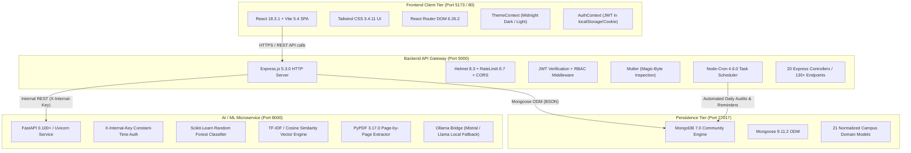

# SmartCampus AI — System Overview & Architecture Blueprint

**Document ID:** `01_PROJECT_OVERVIEW`  
**Version:** 6.0.0  
**Generated Date:** 2026-10-28  
**Repository Working Directory:** `/Users/anurag93/Downloads/CodingZone/MajorProjects/SMARTCAMPUS`  
**Classification:** Technical Documentation Package  
**Target Environment:** Node.js v20+, Python 3.11+, MongoDB 7.0, React 18, Vite 5, Nginx, Docker Compose  

---

## 1. Project Purpose & Abstract

**SmartCampus AI** is an intelligent university campus management, ERP, and student support system designed to modernize academic administration and improve student outcomes through automated workflows and artificial intelligence.

The platform provides a comprehensive multi-role web portal serving three primary stakeholders:
1. **Students:** Course registration, timetable tracking, QR-based classroom attendance, assignment submission, academic performance tracking, fee schedule inspection, online and offline payment reconciliation, official syllabus and study material downloads, and an AI-powered academic assistant providing grounded document question answering (RAG) and personalized study recommendations.
2. **Faculty:** Course curriculum and class routine oversight, attendance recording and dynamic QR session generation, assignment authoring and grading, student risk monitoring, study resource and syllabus upload with automated vector indexing, and departmental notice publishing.
3. **Administrators:** Central institutional governance, role-based registration approvals, student and faculty directory management, department and academic program administration, timetable scheduling, cross-campus attendance auditing, fee structure configuration with version control, financial reconciliation and transaction logging, system health telemetry, and system-wide audit logging.

The system integrates an asynchronous Machine Learning pipeline (Random Forest classifier) for academic early-support detection and a Retrieval-Augmented Generation (RAG) document intelligence engine capable of parsing academic documents (PDF/Text) and answering queries with verifiable page-level citations.

---

## 2. Actual System Architecture

The project is structured as a decoupled microservices and Single Page Application (SPA) architecture composed of four core functional tiers:



### Component Breakdown
1. **Frontend SPA (`client/`):** React 18 with Vite build tooling, styled using Tailwind CSS and Lucide React icons. Features dual-theme support (deep midnight navy aesthetic for dark mode, clean white/slate for light mode), role-guarded route trees, responsive dashboards, and interactive Recharts visualizations. In production, built assets are served by Nginx.
2. **Backend Gateway (`backend/`):** Node.js Express 5.3 service acting as API gateway and business logic processor. Handles user authentication (bcryptjs + JWT), role-based access control, file uploads (profile photos, study materials, receipts), cron jobs for attendance auditing and notice expiries, and database persistence.
3. **Database Layer (`backend/models/`):** MongoDB 7.0 managed via Mongoose 9.11 with 21 individual schema definitions covering users, profiles, courses, departments, timetable, attendance, exams, fees, transactions, and audit logs.
4. **AI/ML Microservice (`ai-service/`):** Python 3.11 service built on FastAPI. Exposes endpoints for academic risk classification, personalized study recommendations, conversational campus assistance, and an end-to-end RAG pipeline that extracts, chunks, vectorizes, and queries university academic literature.

---

## 3. Technology Stack & Runtime Dependencies

The system relies strictly on declared production and development dependencies across manifests:

### Frontend (`client/package.json`)
* **Core Framework:** `react` ^18.3.1, `react-dom` ^18.3.1
* **Routing:** `react-router-dom` ^6.26.2 (configured with React Router v7 future flags)
* **HTTP Client:** `axios` ^1.7.7
* **Data Visualization:** `recharts` ^3.10.1
* **Icons:** `lucide-react` ^0.441.0
* **Build System:** `vite` ^5.4.6, `@vitejs/plugin-react` ^4.3.1
* **Styling:** `tailwindcss` ^3.4.11, `postcss` ^8.4.45, `autoprefixer` ^10.4.20

### Backend Gateway (`backend/package.json`)
* **Server Framework:** `express` ^5.3.0
* **ODM / Database:** `mongoose` ^9.11.2
* **Security & Hardening:** `helmet` ^8.3.0, `cors` ^2.8.6, `express-rate-limit` ^8.7.1, `bcryptjs` ^3.0.3, `jsonwebtoken` ^9.0.3
* **Parsing & Uploads:** `cookie-parser` ^1.4.7, `multer` ^2.4.0
* **Scheduling & Utilities:** `node-cron` ^4.6.0, `qrcode` ^1.5.4, `dotenv` ^18.0.7, `axios` ^1.20.0
* **Testing Stack:** `supertest` ^7.3.1, `mongodb-memory-server` ^11.3.0

### AI Microservice (`ai-service/requirements.txt`)
* **API Framework:** `fastapi` >=0.100.0, `uvicorn[standard]` >=0.23.0
* **Data Validation:** `pydantic` >=2.0.0
* **Machine Learning & Math:** `scikit-learn` >=1.3.0, `numpy` >=1.24.0, `pandas` >=2.0.0, `scipy` >=1.10.0, `joblib` >=1.3.0
* **Document Processing:** `pypdf` >=3.17.0
* **Network & Testing:** `requests` >=2.31.0, `pytest` >=7.4.0

### Containerization & Orchestration (`docker-compose.yml`)
* `smartcampus-mongodb`: `mongo:7.0` container with persistent named volume `smartcampus_mongo_data`.
* `smartcampus-ai-service`: Python 3.11-slim container with persistent vector store volume `smartcampus_rag_vector_store`.
* `smartcampus-backend`: Node.js 20-alpine container dependent on MongoDB and AI Service healthchecks.
* `smartcampus-frontend`: Alpine Nginx container acting as frontend reverse proxy on port 80.

---

## 4. System Boundaries & Communication Interfaces

1. **Client to Backend Gateway:**  
   * Transports: HTTPS (Development via self-signed SAN certificate / Production via reverse proxy).
   * Protocols: RESTful JSON over HTTP, `multipart/form-data` for file uploads.
   * Authentication: Bearer JWT transmitted via `Authorization: Bearer <token>` header or `token` HTTP-only cookie.
2. **Backend Gateway to AI Microservice:**  
   * Transports: Internal Docker network (`smartcampus-net`) or local loopback (`http://localhost:8000`).
   * Authentication: Service-to-service header `X-Internal-Key` validated using constant-time string comparison (`secrets.compare_digest`).
   * Fallback Behavior: If AI Microservice is unreachable or errors out, backend gracefully degrades to rule-based heuristics and local template responses without throwing 500 errors to the frontend.
3. **Backend to Database:**  
   * Transports: Standard MongoDB Wire Protocol (TCP 27017).
   * Connection: Managed through singleton Mongoose connection pool with automatic reconnect and connection-status instrumentation.

---

## 5. User Roles & Permission Matrices

| Role | Scope & Permissions | Key Accessible Modules |
|---|---|---|
| **Student** | Access restricted to personal enrolled data, course syllabi, attendance summaries, results, fee invoices, study resources, and AI assistant. | `/student/dashboard`, `/student/courses`, `/student/attendance`, `/student/timetable`, `/student/assignments`, `/student/results`, `/student/fees`, `/student/resources`, `/student/ai-assistant`, `/student/notices`, `/profile` |
| **Faculty** | Class and student management for assigned courses and departments. Attendance recording, QR session generation, assignment grading, syllabus uploads. | `/faculty/dashboard`, `/faculty/classes`, `/faculty/courses`, `/faculty/attendance`, `/faculty/assignments`, `/faculty/performance`, `/faculty/materials`, `/faculty/notices`, `/profile` |
| **Admin** | Unrestricted institutional control. User approvals, timetable generation, fee structure management, offline payment recording, audit log inspection, system settings. | `/admin/dashboard`, `/admin/registrations`, `/admin/students`, `/admin/faculty`, `/admin/departments`, `/admin/courses`, `/admin/timetable`, `/admin/attendance`, `/admin/fees`, `/admin/notices`, `/admin/analytics`, `/admin/settings`, `/profile` |

---

## 6. Root Directory Structure Overview

The repository is organized into distinct domain folders:

```
SMARTCAMPUS/
├── .github/                     # GitHub Actions CI workflow definitions
│   └── workflows/ci.yml         # 3-tier pipeline (Backend, AI Service, Frontend build)
├── ai-service/                  # Python FastAPI AI, ML and RAG Microservice
│   ├── app/                     # FastAPI core, routes, schemas, ml and rag pipelines
│   ├── tests/                   # Pytest test suites (ML, RAG, Recommendations)
│   ├── Dockerfile               # Production container definition for AI service
│   └── requirements.txt         # Pinned Python package dependencies
├── backend/                     # Node.js Express API Gateway and Business Logic
│   ├── config/                  # Database connectivity and environment validation
│   ├── controllers/             # 20 Express request controllers
│   ├── middleware/              # Auth, RBAC, error handling, file upload filters
│   ├── models/                  # 21 Mongoose schema definitions + CampusModels aggregator
│   ├── routes/                  # 19 Express route modules
│   ├── scripts/                 # Database seeders, backup and restore utilities
│   ├── services/                # AI client, RAG bridge, payments, cron schedulers
│   ├── tests/                   # Supertest backend test suites (API, Fees, Payment, Registration)
│   ├── uploads/                 # Static asset storage for avatars, receipts, documents
│   ├── Dockerfile               # Node.js production container definition
│   └── server.js                # Application entrypoint and lifecycle coordinator
├── client/                      # React SPA with Vite & Tailwind CSS
│   ├── public/                  # Static assets and university vector logos
│   ├── scripts/                 # OpenSSL certificate generation and Windows trust scripts
│   ├── src/                     # React application source code
│   │   ├── components/          # Reusable UI components (Sidebar, Navbar, Layout, Modals)
│   │   ├── context/             # AuthContext and ThemeContext state providers
│   │   ├── pages/               # 31 Role-specific application pages
│   │   └── services/            # Axios API singleton and interceptors
│   ├── tests/                   # Frontend contract and smoke tests
│   ├── Dockerfile               # Frontend multi-stage Nginx container definition
│   ├── nginx.conf               # Nginx reverse proxy configuration
│   └── vite.config.js           # Vite dev server, HTTPS SAN, and Rollup chunking rules
├── scripts/                     # Root process orchestration and live testing scripts
│   ├── start-all.js             # One-command concurrent local runtime manager
│   ├── stop-all.js              # Port-killing shutdown utility
│   ├── verify-live-e2e.js       # Live end-to-end integration verifier
│   └── test-profile-picture.js  # Dedicated avatar upload verification script
├── docker-compose.yml           # Multi-container orchestration definition
├── package.json                 # Root script runner and workspace manifest
└── README.md                    # Primary human-readable documentation
```

---

## 7. Current Implementation Status Summary

* **Phase 1 (Frontend Foundation):** Verified Complete. 31 dedicated pages, role-based navigation sidebar, responsive dashboard layout, dual theme (midnight navy / slate light), accessible error boundaries, and loading skeletons.
* **Phase 2 (Campus Management Backend):** Verified Complete. Normalized Mongoose models, role-based access control, comprehensive CRUD endpoints covering users, departments, courses, attendance, exams, timetable, notices, and registration requests.
* **Phase 3 (Analytics & Automation):** Verified Complete. Dynamic QR code attendance check-in, real-time analytics aggregation, daily cron jobs for attendance reconciliation, and audit log tracking.
* **Phase 4 (AI/ML Intelligence):** Verified Complete. Scikit-learn Random Forest model trained on academic indicators, batch inference for classroom cohorts, personalized curriculum recommendation engine, and resilient fallback execution.
* **Phase 5 (RAG Academic Document Assistant):** Verified Complete. Page-by-page PDF extraction with PyPDF, overlapping text chunking, persistent TF-IDF vector indexing, cosine similarity retrieval, verifiable citation formatting, and prompt-injection defenses.
* **Phase 6 (Production Readiness & DevOps):** Implemented & Verified. Docker Compose orchestration, GitHub Actions CI matrix running 65+ automated tests, database backup/restore scripts, healthcheck liveness/readiness probes, and OpenSSL SAN development certificates.

---

## 8. Important Architectural Limitations & Disclaimers

1. **Local Vector Storage:** The RAG vector store relies on an in-memory/joblib-persisted Scikit-Learn TF-IDF vectorizer and cosine similarity matrix rather than a dedicated external vector database (such as Milvus, Qdrant, or Pinecone). This is optimal for campus workloads under ~50,000 document chunks but will require migration if scaling to millions of documents.
2. **Local Machine Dependency for AI Ingest:** PDF extraction requires sufficient system memory when processing massive textbooks (>50MB). The backend limits uploads to 10MB to maintain responsive latency.
3. **Internal Auth Key Default:** In development mode, `INTERNAL_AI_KEY` uses a fallback secret if unconfigured in `.env`. Production deployments must enforce cryptographically secure entropy via container environment variables.

