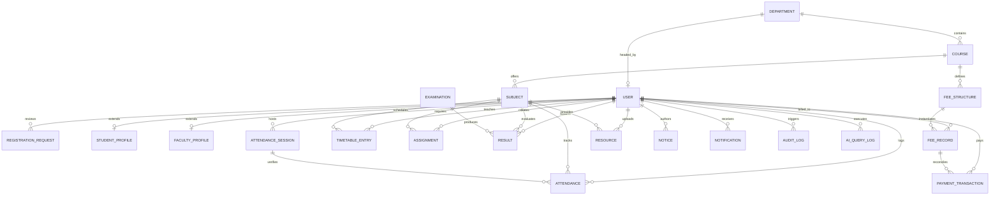

# SmartCampus AI — Database Architecture & Mongoose Schema Reference

**Document ID:** `05_DATABASE_SCHEMA_AND_RELATIONSHIPS`  
**Version:** 6.0.0  
**Generated Date:** 2026-10-28  
**Repository Working Directory:** `/Users/anurag93/Downloads/CodingZone/MajorProjects/SMARTCAMPUS/backend/models`  
**Classification:** Database Architecture, Schema Catalog & Entity-Relationship Model  

---

## 1. Database Architecture & Connection Settings

SmartCampus AI utilizes **MongoDB 7.0 Community Edition** managed via the **Mongoose 9.11.2** Object-Data Modeling (ODM) library for Node.js.

### 1.1 Connection Settings & Resiliency (`backend/config/database.js`)
* **Connection Parameter Variable:** `MONGODB_URI` (Default: `mongodb://localhost:27017/smartcampus`).
* **Connection Pool Configuration:**
  * `maxPoolSize`: 10 persistent socket connections.
  * `serverSelectionTimeoutMS`: 5000ms fail-fast boundary.
  * `autoIndex`: Automatically enabled in development; disabled in production for deterministic index builds.
* **Telemetry Instrumentation:** `getDbStatus()` inspects `mongoose.connection.readyState` returning:
  * `connected` (boolean)
  * `readyState` (0=Disconnected, 1=Connected, 2=Connecting, 3=Disconnecting)
  * `host` and `name` (Database collection target)

---

## 2. Complete Model Catalog (21 Domain Entities)

The database schema is organized into 21 normalized models exported individually and re-exported via `CampusModels.js`.

### 2.1 Identity & Access Control Models

#### `User` (`backend/models/User.js`)
* **Collection Name:** `users`
* **Purpose:** Core identity entity representing students, faculty members, and institutional administrators.
* **Fields:**
  * `name`: `String` (Required, trim, max 100)
  * `email`: `String` (Required, unique, lowercase, trim, regex validated)
  * `password`: `String` (Required, bcrypt hash with 10 salt rounds, `select: false` by default)
  * `role`: `String` (Enum: `['student', 'faculty', 'admin']`, default `'student'`, indexed)
  * `department`: `String` (Required, trim, uppercase)
  * `phone`: `String` (Trim, default `''`)
  * `avatar`: `String` (Default `DEFAULT_AVATAR_URL`)
  * `isActive`: `Boolean` (Default `true`)
  * `registrationRequest`: `ObjectId` (Ref `RegistrationRequest`, optional)
* **Indexes:** `{ email: 1 }` (unique), `{ role: 1 }`, `{ department: 1 }`
* **Hooks & Methods:**
  * `pre('save')`: Hashes modified passwords using `bcrypt.hash(password, 10)`.
  * `comparePassword(candidatePassword)`: Compares candidate plaintext with stored hash.

#### `RegistrationRequest` (`backend/models/RegistrationRequest.js`)
* **Collection Name:** `registrationrequests`
* **Purpose:** Prospective student/faculty applications submitted via the public registration portal.
* **Fields:**
  * `name`: `String` (Required)
  * `email`: `String` (Required, lowercase, trim)
  * `password`: `String` (Required, bcrypt hashed)
  * `role`: `String` (Enum: `['student', 'faculty']`)
  * `department`: `String` (Required)
  * `rollNumber`: `String` (Required for students)
  * `semester`: `Number` (Default 1)
  * `phone`: `String`
  * `status`: `String` (Enum: `['pending', 'approved', 'rejected']`, default `'pending'`, indexed)
  * `reviewedBy`: `ObjectId` (Ref `User`)
  * `reviewedAt`: `Date`
  * `rejectionReason`: `String`

---

### 2.2 Academic Profiles & Departmental Hierarchy

#### `Department` (`backend/models/Department.js`)
* **Collection Name:** `departments`
* **Fields:**
  * `name`: `String` (Required, unique, trim)
  * `code`: `String` (Required, unique, uppercase, trim, e.g. `'BCA'`, `'CSE'`)
  * `headOfDepartment`: `ObjectId` (Ref `User`, optional)
  * `description`: `String` (Default `''`)
* **Indexes:** `{ code: 1 }` (unique), `{ name: 1 }` (unique)

#### `Course` (`backend/models/Course.js`)
* **Collection Name:** `courses`
* **Fields:**
  * `name`: `String` (Required, trim)
  * `code`: `String` (Required, unique, uppercase, trim)
  * `department`: `String` (Required, uppercase)
  * `durationSemesters`: `Number` (Required, default 6)
  * `creditsRequired`: `Number` (Required, default 120)
  * `description`: `String` (Default `''`)

#### `Subject` (`backend/models/Subject.js`)
* **Collection Name:** `subjects`
* **Fields:**
  * `name`: `String` (Required, trim)
  * `code`: `String` (Required, unique, uppercase, trim)
  * `courseCode`: `String` (Required, uppercase)
  * `semester`: `Number` (Required, min 1, max 12)
  * `credits`: `Number` (Required, default 4)
  * `type`: `String` (Enum: `['Core', 'Elective', 'Lab']`, default `'Core'`)
  * `faculty`: `ObjectId` (Ref `User`)

#### `StudentProfile` (`backend/models/StudentProfile.js`)
* **Collection Name:** `studentprofiles`
* **Fields:**
  * `user`: `ObjectId` (Ref `User`, required, unique)
  * `rollNumber`: `String` (Required, unique, uppercase)
  * `semester`: `Number` (Required, default 1)
  * `batch`: `String` (Required, e.g. `'2024-2027'`)
  * `academicStatus`: `String` (Enum: `['Active', 'On Probation', 'Graduated', 'Suspended']`, default `'Active'`)
  * `guardianName`: `String`
  * `guardianPhone`: `String`
  * `cgpa`: `Number` (Default 0.0)

#### `FacultyProfile` (`backend/models/FacultyProfile.js`)
* **Collection Name:** `facultyprofiles`
* **Fields:**
  * `user`: `ObjectId` (Ref `User`, required, unique)
  * `employeeId`: `String` (Required, unique, uppercase)
  * `designation`: `String` (Required, default `'Assistant Professor'`)
  * `qualifications`: `[String]` (e.g. `['M.Tech', 'Ph.D']`)
  * `officeRoom`: `String`
  * `officeHours`: `String`

---

### 2.3 Operations: Attendance, Timetable & Coursework

#### `AttendanceSession` (`backend/models/AttendanceSession.js`)
* **Fields:**
  * `faculty`: `ObjectId` (Ref `User`, required)
  * `subject`: `ObjectId` (Ref `Subject`, required)
  * `subjectCode`: `String` (Required)
  * `courseCode`: `String` (Required)
  * `semester`: `Number` (Required)
  * `sessionToken`: `String` (Required, unique, cryptographic hex)
  * `qrCodeDataUrl`: `String` (Required data URI)
  * `expiresAt`: `Date` (Required)
  * `isActive`: `Boolean` (Default `true`)
* **Indexes:** `{ sessionToken: 1 }` (unique), `{ expiresAt: 1 }` (TTL index candidate)

#### `Attendance` (`backend/models/Attendance.js`)
* **Fields:**
  * `student`: `ObjectId` (Ref `User`, required)
  * `subject`: `ObjectId` (Ref `Subject`, required)
  * `date`: `Date` (Required)
  * `status`: `String` (Enum: `['Present', 'Absent', 'Late']`, default `'Present'`)
  * `session`: `ObjectId` (Ref `AttendanceSession`, optional)
  * `verifiedMethod`: `String` (Enum: `['Manual', 'QR_Dynamic', 'BioMetric']`, default `'Manual'`)
* **Compound Index:** `{ student: 1, subject: 1, date: 1 }` (unique check prevents duplicate roll-call entries per day)

#### `TimetableEntry` (`backend/models/TimetableEntry.js`)
* **Fields:**
  * `courseCode`: `String` (Required)
  * `semester`: `Number` (Required)
  * `subject`: `ObjectId` (Ref `Subject`, required)
  * `faculty`: `ObjectId` (Ref `User`, required)
  * `dayOfWeek`: `String` (Enum: `['Monday', 'Tuesday', 'Wednesday', 'Thursday', 'Friday', 'Saturday']`)
  * `startTime`: `String` (e.g. `'09:00'`)
  * `endTime`: `String` (e.g. `'10:00'`)
  * `room`: `String` (Required)
* **Compound Indexes:** `{ courseCode: 1, semester: 1, dayOfWeek: 1, startTime: 1 }`

#### `Assignment` (`backend/models/Assignment.js`)
* **Fields:**
  * `title`: `String` (Required, trim)
  * `description`: `String`
  * `subject`: `ObjectId` (Ref `Subject`, required)
  * `faculty`: `ObjectId` (Ref `User`, required)
  * `dueDate`: `Date` (Required)
  * `totalMarks`: `Number` (Default 100)
  * `submissions`: Array of subdocuments:
    * `student`: `ObjectId` (Ref `User`, required)
    * `submissionDate`: `Date` (Default `Date.now`)
    * `fileUrl`: `String`
    * `content`: `String`
    * `grade`: `Number`
    * `feedback`: `String`

#### `Examination` (`backend/models/Examination.js`)
* **Fields:**
  * `name`: `String` (Required, e.g. `'Mid-Term Examination Fall 2026'`)
  * `courseCode`: `String` (Required)
  * `semester`: `Number` (Required)
  * `examType`: `String` (Enum: `['Mid-Term', 'Final', 'Practical']`)
  * `startDate`: `Date`
  * `endDate`: `Date`
  * `schedules`: Array of `{ subjectCode, date, startTime, durationMinutes, maxMarks }`

#### `Result` (`backend/models/Result.js`)
* **Fields:**
  * `student`: `ObjectId` (Ref `User`, required)
  * `examination`: `ObjectId` (Ref `Examination`, required)
  * `subject`: `ObjectId` (Ref `Subject`, required)
  * `marksObtained`: `Number` (Required, min 0)
  * `maxMarks`: `Number` (Required, default 100)
  * `grade`: `String` (e.g. `'A+'`, `'A'`, `'B'`, `'F'`)
  * `gradePoints`: `Number` (0 to 10 scale)
* **Compound Index:** `{ student: 1, examination: 1, subject: 1 }` (unique)

---

### 2.4 Financials: Fee Structures, Invoices & Payment Transactions

#### `FeeStructure` (`backend/models/FeeStructure.js`)
* **Purpose:** Academic program fee specifications with versioning and approval workflow.
* **Fields:**
  * `title`: `String` (Required)
  * `courseCode`: `String` (Required, uppercase)
  * `academicYear`: `String` (Required, e.g. `'2026-2027'`)
  * `version`: `Number` (Default 1)
  * `status`: `String` (Enum: `['Draft', 'Published', 'Archived']`, default `'Draft'`)
  * `categories`: Subdocuments containing `feeType`, `categoryName`, `amount`, `isMandatory`, `frequency`
  * `totalAnnualFee`: `Number` (Auto-summed pre-save)
  * `createdBy`: `ObjectId` (Ref `User`)
* **Compound Index:** `{ courseCode: 1, academicYear: 1, version: 1 }` (unique)

#### `FeeRecord` (`backend/models/FeeRecord.js`)
* **Purpose:** Individual student financial invoice ledger.
* **Fields:**
  * `student`: `ObjectId` (Ref `User`, required, indexed)
  * `feeStructure`: `ObjectId` (Ref `FeeStructure`, optional)
  * `feeType`: `String` (Enum: `['Tuition Fee', 'Examination Fee', 'Lab Fee', 'Library Fee', 'Hostel Fee', 'Other']`)
  * `semester`: `Number` (Default 5)
  * `totalAmount`: `Number` (Required, min 0)
  * `paidAmount`: `Number` (Default 0, min 0)
  * `balanceAmount`: `Number` (Auto-calculated: `totalAmount - paidAmount`)
  * `dueDate`: `Date` (Required)
  * `status`: `String` (Enum: `['Paid', 'Partial', 'Pending', 'Overdue']`, default `'Pending'`)
  * `receiptNumber`: `String` (Default `''`)
  * `remarks`: `String`
* **Pre-save Hook:** Automatically evaluates `balanceAmount = max(0, totalAmount - paidAmount)`. Updates `status` to `'Paid'` when balance is 0, `'Partial'` when payments exist, or `'Overdue'` if date exceeded.

#### `PaymentTransaction` (`backend/models/PaymentTransaction.js`)
* **Purpose:** Immutable audit record of payment checkout attempts across Razorpay and offline remittances.
* **Fields:**
  * `student`: `ObjectId` (Ref `User`, required, indexed)
  * `feeRecord`: `ObjectId` (Ref `FeeRecord`, required, indexed)
  * `orderId`: `String` (Required, unique, indexed)
  * `paymentId`: `String` (Razorpay payment ID or cash receipt reference)
  * `signature`: `String` (HMAC-SHA256 signature)
  * `amount`: `Number` (Required, min 1)
  * `currency`: `String` (Default `'INR'`)
  * `status`: `String` (Enum: `['Created', 'Attempted', 'Captured', 'Failed', 'Refunded']`, default `'Created'`)
  * `paymentMethod`: `String` (Enum: `['UPI', 'Card', 'NetBanking', 'Wallet', 'Cash', 'DemandDraft', 'BankTransfer']`)
  * `ipAddress`: `String`

---

### 2.5 Knowledge Base, Communication & System Telemetry

#### `Resource` (`backend/models/Resource.js`)
* **Fields:**
  * `title`: `String` (Required, trim)
  * `subject`: `ObjectId` (Ref `Subject`)
  * `subjectCode`: `String` (Required, indexed)
  * `courseCode`: `String` (Required, indexed)
  * `fileUrl`: `String` (Required)
  * `fileType`: `String` (Enum: `['pdf', 'doc', 'ppt', 'txt']`)
  * `fileSizeBytes`: `Number`
  * `uploadedBy`: `ObjectId` (Ref `User`, required)
  * `ragIndexed`: `Boolean` (Default `false`, indexed)
  * `chunkCount`: `Number` (Default 0)

#### `Notice` (`backend/models/Notice.js`)
* **Fields:**
  * `title`: `String` (Required, trim)
  * `content`: `String` (Required)
  * `category`: `String` (Enum: `['Academic', 'Exam', 'Event', 'Emergency', 'General']`, default `'General'`)
  * `priority`: `String` (Enum: `['Low', 'Medium', 'High', 'Urgent']`, default `'Medium'`)
  * `targetAudience`: `String` (Enum: `['All', 'Students', 'Faculty', 'Department']`, default `'All'`)
  * `author`: `ObjectId` (Ref `User`, required)
  * `expiresAt`: `Date`

#### `Notification` (`backend/models/Notification.js`)
* **Fields:**
  * `recipient`: `ObjectId` (Ref `User`, required, indexed)
  * `title`: `String` (Required)
  * `message`: `String` (Required)
  * `type`: `String` (Enum: `['Info', 'Success', 'Warning', 'Alert']`, default `'Info'`)
  * `read`: `Boolean` (Default `false`, indexed)
  * `link`: `String`

#### `AuditLog` (`backend/models/AuditLog.js`)
* **Fields:**
  * `actor`: `ObjectId` (Ref `User`, required, indexed)
  * `action`: `String` (Required, e.g. `'CREATE_COURSE'`, `'APPROVE_REGISTRATION'`, `'OFFLINE_PAYMENT'`)
  * `targetModel`: `String` (Required)
  * `targetId`: `String`
  * `details`: `mongoose.Schema.Types.Mixed`
  * `ipAddress`: `String`

#### `AIQueryLog` (`backend/models/AIQueryLog.js`)
* **Fields:**
  * `user`: `ObjectId` (Ref `User`, required, indexed)
  * `query`: `String` (Required)
  * `responseLength`: `Number`
  * `latencyMs`: `Number`
  * `engine`: `String` (Default `'FastAPI-Heuristic'`)

---

## 3. Entity-Relationship Model (Mermaid ER Diagram)

---

## 4. Database Integrity Observations

1. **Unique Indexes Safeguards:** Strict compound unique indexes prevent logical race conditions:
   * `{ student: 1, subject: 1, date: 1 }` prevents double-recording daily attendance.
   * `{ student: 1, examination: 1, subject: 1 }` prevents duplicate grades for the same exam paper.
   * `{ orderId: 1 }` on `PaymentTransaction` guarantees Razorpay idempotency.
2. **Pre-Save Ledger Balancing:** The `FeeRecord` schema automatically recomputes `balanceAmount` whenever `paidAmount` is updated, preventing ledger drift between manual payments and payment gateway webhooks.
3. **Password Security:** The `User` schema enforces `select: false` on the `password` field, ensuring database queries (`find`, `findOne`, `populate`) do not inadvertently leak password hashes to response payloads unless explicitly requested via `.select('+password')`.

