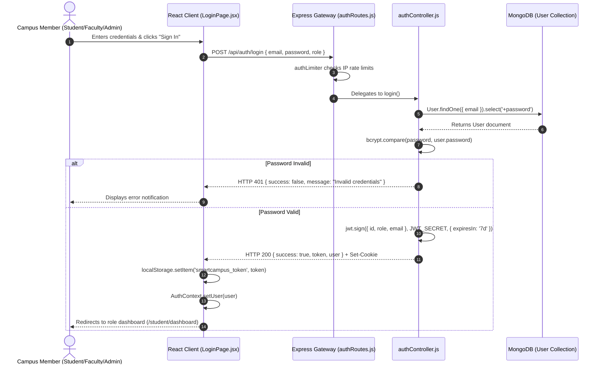
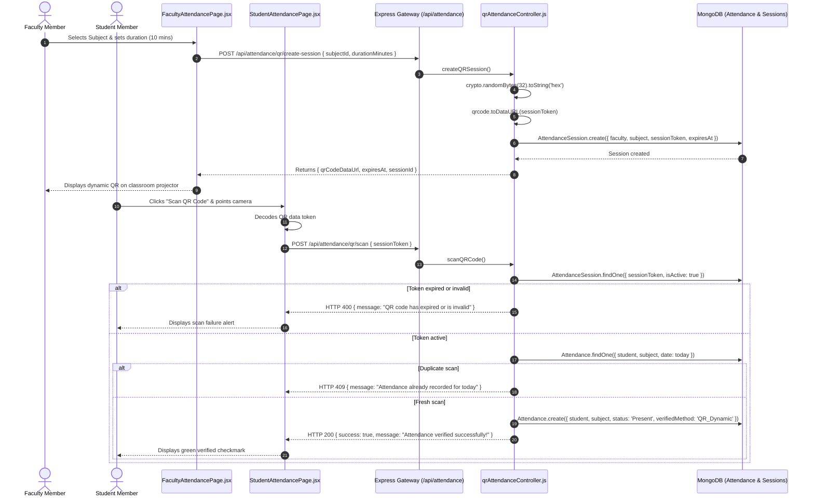
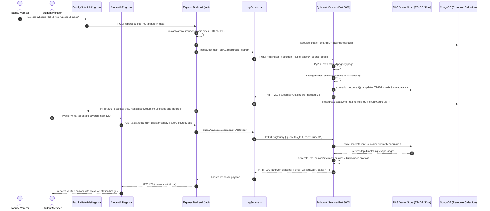
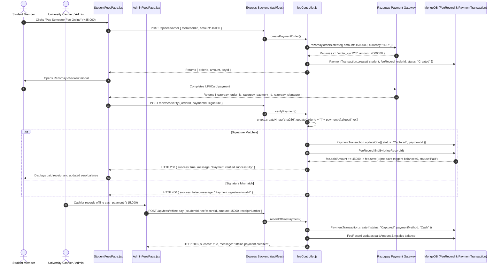

# SmartCampus AI — End-to-End Data Flow & Integration Map

**Document ID:** `06_DATA_FLOW_AND_INTEGRATION_MAP`  
**Version:** 6.0.0  
**Generated Date:** 2026-10-28  
**Repository Working Directory:** `/Users/anurag93/Downloads/CodingZone/MajorProjects/SMARTCAMPUS`  
**Classification:** System Integration Matrix & End-to-End Workflow Traces  

---

## 1. Architectural Data Flow Overview

Every user interaction in SmartCampus AI follows a deterministic, unidirectional multi-tier data pipeline:

$$\text{User Action} \longrightarrow \text{React Component} \longrightarrow \text{State Handler} \longrightarrow \text{Axios API Client} \longrightarrow \text{HTTP REST} \longrightarrow \text{Express Gateway} \longrightarrow \text{Middlewares (Auth/RBAC/RateLimit)} \longrightarrow \text{Controller} \longrightarrow \text{Downstream Service (Mongoose / FastAPI)} \longrightarrow \text{JSON Response} \longrightarrow \text{React State} \longrightarrow \text{Re-rendered UI}$$

---

## 2. Comprehensive Data-Flow Matrix

| Major Workflow | Frontend Component | API Endpoint | Middleware Stack | Controller / Service | Downstream Persistence / Engine | Status |
|---|---|---|---|---|---|---|
| **User Login** | `LoginPage.jsx` | `POST /api/auth/login` | `authLimiter`, `validateLogin` | `authController.login` | Queries `User`, verifies `bcrypt`, issues JWT | Verified Complete |
| **Registration Application** | `RegisterPage.jsx` | `POST /api/auth/register` | `authLimiter`, `validateRegister` | `authController.register` | Writes `RegistrationRequest` (status: pending) | Verified Complete |
| **Admin Registration Approval** | `AdminRegistrationsPage.jsx` | `POST /api/admin/registration-requests/:id/approve` | `authenticate`, `authorize('admin')` | `registrationController.approve` | Creates `User` + `StudentProfile`, marks approved | Verified Complete |
| **Profile Photo Upload** | `ProfilePictureModal.jsx` | `POST /api/users/me/profile-picture` | `authenticate`, `uploadAvatar` (Multer) | `userController.uploadProfilePicture` | Magic-byte checks, writes disk file, updates `User.avatar` | Verified Complete |
| **Student Timetable Lookup** | `StudentTimetablePage.jsx` | `GET /api/timetable` | `authenticate` | `timetableController.getTimetable` | Queries `TimetableEntry` populated with `Subject` | Verified Complete |
| **QR Session Generation** | `FacultyAttendancePage.jsx` | `POST /api/attendance/qr/create-session` | `authenticate`, `authorize('faculty')` | `qrAttendanceController.createSession` | Generates token, renders QR data URI, creates `AttendanceSession` | Verified Complete |
| **Student QR Check-in** | `StudentAttendancePage.jsx` | `POST /api/attendance/qr/scan` | `authenticate`, `authorize('student')` | `qrAttendanceController.scanQRCode` | Validates session expiration, writes `Attendance` record | Verified Complete |
| **Assignment Submission** | `StudentAssignmentsPage.jsx` | `POST /api/assignments/:id/submit` | `authenticate`, `authorize('student')` | `assignmentController.submit` | Pushes submission into `Assignment.submissions` array | Verified Complete |
| **Assignment Grading** | `FacultyAssignmentsPage.jsx` | `POST /api/assignments/:id/grade` | `authenticate`, `authorize('faculty')` | `assignmentController.grade` | Sets grade & feedback, issues `Notification` | Verified Complete |
| **Transcript GPA Inspection** | `StudentResultsPage.jsx` | `GET /api/results/my` | `authenticate`, `authorize('student')` | `examController.getMyResults` | Aggregates `Result` collection, calculates SGPA/CGPA | Verified Complete |
| **Fee Structure Definition** | `AdminFeesPage.jsx` | `POST /api/fees/structures` | `authenticate`, `authorize('admin')` | `feeStructureController.create` | Validates categories, saves `FeeStructure` (Draft) | Verified Complete |
| **Online Payment Checkout** | `StudentFeesPage.jsx` | `POST /api/fees/order` | `authenticate` | `feeController.createPaymentOrder` | Calls Razorpay SDK, writes `PaymentTransaction` | Verified Complete |
| **Payment Signature Verification** | `StudentFeesPage.jsx` | `POST /api/fees/verify` | `authenticate` | `feeController.verifyPayment` | HMAC-SHA256 signature check, credits `FeeRecord.paidAmount` | Verified Complete |
| **Offline Cash Payment Recording** | `AdminFeesPage.jsx` | `POST /api/fees/offline-pay` | `authenticate`, `authorize('admin')` | `feeController.recordOfflinePayment` | Creates `PaymentTransaction`, recalculates `FeeRecord` | Verified Complete |
| **Notice Publishing** | `FacultyNoticesPage.jsx` | `POST /api/notices` | `authenticate`, `authorize('faculty')` | `noticeController.createNotice` | Writes `Notice`, broadcasts `Notification` | Verified Complete |
| **Study Material Upload & RAG Index** | `FacultyMaterialsPage.jsx` | `POST /api/resources` | `authenticate`, `uploadMaterial` | `resourceController.upload` $\rightarrow$ `ragService` | Saves file, posts base64 to FastAPI `/rag/ingest`, chunks & vectors | Verified Complete |
| **Grounded Document Q&A (RAG)** | `StudentAIPage.jsx` | `POST /api/ai/document-assistant/query` | `aiLimiter`, `authenticate` | `aiController` $\rightarrow$ `ragService` | FastAPI `/rag/query`: TF-IDF cosine match, formats citations | Verified Complete |
| **Academic Early-Risk Analysis** | `FacultyPerformancePage.jsx` | `GET /api/ai/early-support` | `authenticate`, `authorize('faculty')` | `aiController` $\rightarrow$ `aiService` | Pulls class attendance/grades, FastAPI evaluates Random Forest | Verified Complete |
| **Personalized Recommendations** | `StudentAIPage.jsx` | `GET /api/ai/recommendations` | `authenticate` | `aiController` $\rightarrow$ `aiService` | FastAPI evaluates weak areas, returns curated library links | Verified Complete |
| **Automated Attendance Audit** | Background Node-Cron | Local Cron Trigger (Daily 02:00) | Server Internal | `schedulerService.initScheduler` | Queries non-compliant attendance, writes `AuditLog` | Verified Complete |
| **Database Backup** | `scripts/backupDatabase.js` | CLI Command (`npm run backup`) | Local Server Process | `runBackup()` | Dumps 21 Mongoose collections to timestamped JSON files | Verified Complete |

---

## 3. Detailed Sequence Diagrams for Critical Workflows

### 3.1 Authentication & Session Issuance Workflow

---

### 3.2 Dynamic QR Attendance Check-In Workflow

---

### 3.3 Study Material Upload, Automated RAG Vectorization & Question-Answering

---

### 3.4 Academic Fee Checkout & Payment Reconciliation

