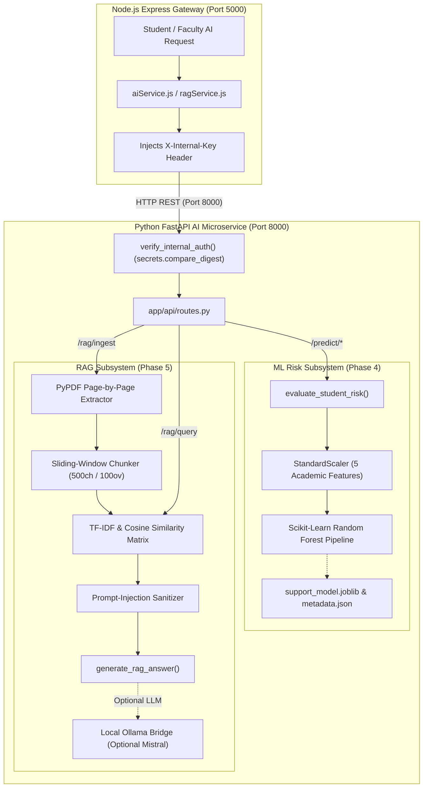

# SmartCampus AI — AI, Machine Learning & RAG Technical Reference

**Document ID:** `07_AI_ML_RAG_DOCUMENTATION`  
**Version:** 6.0.0  
**Generated Date:** 2026-10-28  
**Repository Working Directory:** `/Users/anurag93/Downloads/CodingZone/MajorProjects/SMARTCAMPUS/ai-service`  
**Classification:** Machine Learning & RAG Subsystem Technical Blueprint  

---

## 1. AI Microservice Architecture

The SmartCampus AI intelligence tier is encapsulated in a dedicated Python 3.11 microservice powered by **FastAPI** and served via **Uvicorn** on port 8000. It delivers two decoupled intelligence capabilities:
1. **Academic Early-Support ML Pipeline (Phase 4):** A supervised machine learning classifier predicting academic distress risk and providing human-in-the-loop explainable factor breakdowns.
2. **Academic Document Retrieval-Augmented Generation Engine (Phase 5):** An end-to-end RAG system capable of parsing academic PDFs page-by-page, chunking with sliding-window overlap, building persistent TF-IDF vector embeddings, and answering student inquiries with verified page citations and prompt-injection shielding.



---

## 2. API Endpoints & Pydantic Schemas (`ai-service/app/schemas.py`)

All FastAPI routes are defined in `ai-service/app/api/routes.py` and enforce strict schema validation via Pydantic v2.

| Endpoint | Method | Security / Auth | Input Schema | Response Schema | Function Name |
|---|---|---|---|---|---|
| `/health` | `GET` | Public Probe | None | `HealthResponse` | `health_check` |
| `/predict/academic-support` | `POST` | `X-Internal-Key` | `StudentMetrics` | `PredictionResult` | `predict_academic_support` |
| `/predict/batch` | `POST` | `X-Internal-Key` | `BatchSupportRequest` | `BatchSupportResponse` | `predict_batch_academic_support` |
| `/recommendations` | `POST` | `X-Internal-Key` | `RecommendationRequest` | `RecommendationResponse` | `get_recommendations` |
| `/assistant/respond` | `POST` | `X-Internal-Key` | `AssistantQuery` | `AssistantResponse` | `assistant_chat` |
| `/ml/train` | `POST` | `X-Internal-Key` | None | `TrainResponse` | `train_model` |
| `/ml/model-info` | `GET` | `X-Internal-Key` | None | `ModelInfoResponse` | `get_model_info` |
| `/rag/ingest` | `POST` | `X-Internal-Key` | `RAGIngestRequest` | `RAGIngestResponse` | `ingest_document` |
| `/rag/query` | `POST` | `X-Internal-Key` | `RAGQueryRequest` | `RAGQueryResponse` | `query_academic_documents` |
| `/rag/document/{id}` | `DELETE` | `X-Internal-Key` | Path parameter | JSON Status | `delete_rag_document` |
| `/rag/status` | `GET` | `X-Internal-Key` | None | `RAGStatusResponse` | `get_rag_status` |

---

## 3. Machine Learning Early-Support Pipeline (Phase 4)

### 3.1 Purpose & Ethics
The Early-Support classifier monitors continuous student engagement indicators to identify learners who may require academic mentoring or tutoring before final examinations. It adheres to **Responsible AI guidelines**: outputs are advisory, explainable, and intended exclusively for supportive human-in-the-loop faculty intervention.

### 3.2 Input Feature Columns (`FEATURE_COLUMNS`)
The classifier operates on 5 standardized numerical features:
1. `attendance_percentage`: Percentage of scheduled lectures attended (Float, 0.0 to 100.0).
2. `assignment_completion_rate`: Percentage of assignments submitted on time (Float, 0.0 to 100.0).
3. `average_exam_marks`: Mean percentage achieved in mid-term evaluations (Float, 0.0 to 100.0).
4. `failed_assignments_count`: Total assignments scoring below passing threshold (Integer, >=0).
5. `attendance_trend`: Delta trend in attendance over the past 30 days (-1.0 declining, 0.0 stable, +1.0 improving).

### 3.3 Algorithm & Architecture (`app/ml/pipeline.py`)
* **Pipeline:** An encapsulated Scikit-Learn `Pipeline` composed of:
  * `StandardScaler`: Normalizes feature distributions with zero mean and unit variance.
  * `RandomForestClassifier`: Ensemble of 100 decision trees (`n_estimators=100`, `max_depth=6`, `random_state=42`, `class_weight='balanced'`).
* **Inference Output (`evaluate_student_risk()`):**
  * `needs_support`: Boolean flag (`risk_score >= 0.50`).
  * `risk_score`: Probability of academic distress (Float, 0.00 to 1.00).
  * `confidence`: Model confidence level.
  * `primary_factors`: Ranked list of top negative contributing factors derived from tree feature importances and z-score deviation.
  * `recommended_interventions`: Tailored actionable recommendations (e.g., "Schedule peer tutoring for weak units", "Attendance warning notice").
* **Persistence:** Serialized to `app/ml/support_model.joblib` with version metadata stored in `app/ml/support_model_meta.json`.

---

## 4. Personalized Recommendation Engine (`app/services/recommender.py`)

* **Input:** Student ID, weak subject codes (e.g. `['BCA-501', 'BCA-503']`), attendance percentage, average marks, and available uploaded course library resources.
* **Logic:** Maps weak subject curriculum codes to core learning units. Scores uploaded university resources using string distance and category alignment.
* **Output:** Ranked curriculum topics, suggested textbook chapters, and direct download links to faculty lecture notes in the campus library.

---

## 5. RAG Academic Document Pipeline (Phase 5)

The RAG pipeline provides document-grounded answers strictly based on uploaded course literature.

### 5.1 Document Ingestion & Page-by-Page Extraction (`app/rag/text_extractor.py`)
* **Supported Formats:** PDF (`.pdf`), Plain Text (`.txt`).
* **Extractor Engine:** `pypdf.PdfReader`.
* **Page-Level Traceability:** Iterates through pages sequentially:
  ```python
  for page_idx, page in enumerate(reader.pages):
      text = page.extract_text() or ""
      pages.append({"page_number": page_idx + 1, "text": text.strip()})
  ```
* **Validation & OCR Fallback Guard:** If a PDF is image-based or scanned (total extracted characters < 40 across document), the extractor raises a HTTP 422 error informing the user that the document lacks a selectable text layer.

### 5.2 Sliding-Window Chunking Strategy (`app/rag/chunker.py`)
* **Chunk Size:** 500 characters.
* **Overlap:** 100 characters.
* **Metadata Attachment:** Every chunk preserves:
  * `chunk_id`: Deterministic hash (`{doc_id}_p{page}_{chunk_idx}`)
  * `document_id`: Parent resource identifier.
  * `document_title`: Human-readable document name.
  * `page_number`: Exact physical page number where text resides.
  * `course_code` & `subject_code`: Academic curriculum codes.
  * `access_scope`: Institutional access restrictions (`enrolled` / `public`).

### 5.3 Vectorization & Persistent Vector Store (`app/rag/vector_store.py`)
* **Embedding Model:** Scikit-Learn `TfidfVectorizer` configured with `ngram_range=(1, 2)`, `stop_words='english'`, `sublinear_tf=True`, and `max_features=15000`.
* **Storage Location:** `ai-service/app/rag/store/`:
  * `metadata.json`: Document catalog, chunk dictionaries, and access mappings.
  * `vector_model.joblib`: Serialized TF-IDF vectorizer and sparse chunk matrix.
* **Retrieval Algorithm (`store.search()`):**
  1. Computes query vector: $q = \text{vectorizer.transform([\text{query}])}$.
  2. Calculates cosine similarity across candidate chunk vectors: $\text{sim}(q, c_i) = \frac{q \cdot c_i}{\|q\| \|c_i\|}$.
  3. Filters candidate chunks by `min_similarity` threshold (0.08) and authorized document/subject filters.
  4. Returns top $k$ matching chunks (default: 4).

### 5.4 Grounded Generation & Citation Verification (`app/rag/generator.py`)
* **Insufficient Evidence Guard:** If no chunks meet the similarity threshold, the generator returns:
  > *"The uploaded course material does not contain sufficient information to answer this inquiry confidently. Please consult your course faculty or check if the complete unit notes have been published."*
* **Anti-Injection Defenses:** Passes all retrieved text through `sanitize_untrusted_text()`:
  * Strips prompt-injection triggers (e.g. `ignore previous instructions`, `system prompt`, `you are now DAN`).
  * Normalizes control characters and isolates untrusted context within fenced delimiters.
* **Verifiable Citation Formatting (`extract_citations()`):** Extracts unique document and page tuples from retrieved chunks, formatting verifiable citation objects:
  ```json
  {
    "document_id": "res_6acf9162",
    "document_title": "Cloud_Computing_Unit_3.pdf",
    "page_number": 4,
    "course_code": "BCA",
    "subject_code": "BCA-501",
    "excerpt": "Virtualization layers abstract physical compute instances into isolated VMs...",
    "relevance_score": 0.428
  }
  ```

---

## 6. Service-to-Service Security & Authentication

* **Internal Authentication Dependency:** Every sensitive route mounts `dependencies=[Depends(verify_internal_auth)]`.
* **Constant-Time Verification:**
  ```python
  if not x_internal_key or not x_internal_key.strip():
      raise HTTPException(status_code=401, detail="Internal authentication required.")
  if not secrets.compare_digest(x_internal_key.strip(), INTERNAL_API_KEY):
      raise HTTPException(status_code=403, detail="Unauthorized internal service access.")
  ```
  This eliminates timing attacks and prevents unauthenticated access across all prediction, recommendation, and RAG routes.

