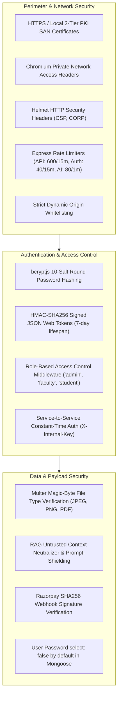

# SmartCampus AI — Security Architecture & Configuration Audit

**Document ID:** `08_SECURITY_AND_CONFIGURATION`  
**Version:** 6.0.0  
**Generated Date:** 2026-10-28  
**Repository Working Directory:** `/Users/anurag93/Downloads/CodingZone/MajorProjects/SMARTCAMPUS`  
**Classification:** Security Architecture & Secret Management Audit  

---

## 1. Security Architecture Overview

SmartCampus AI employs a defense-in-depth security model across authentication, authorization, communication encryption, input sanitization, file uploads, and service-to-service interfaces.



---

## 2. Authentication & Identity Controls

### 2.1 Password Security & Hashing
* **Algorithm:** `bcryptjs` utilizing 10 salt rounds.
* **Storage Policy:** Mongoose `User` schema sets `select: false` on the `password` field. Direct queries (`User.find()`, `User.findOne()`) automatically exclude password hashes from result objects, preventing accidental data leakage to frontend clients.
* **Pre-save Trigger:** Hashes passwords only when `isModified('password') === true`.

### 2.2 Token Management & Session Lifespan
* **Token Standard:** JSON Web Token (JWT) signed with HMAC-SHA256 (`jsonwebtoken` ^9.0.3).
* **Payload Structure:** Contains `id`, `role`, `email`.
* **Expiration Policy:** Default lifespan: 7 days (`7d`).
* **Transport Mechanisms:** Dual transport support:
  1. `Authorization: Bearer <token>` HTTP header (standard for SPA).
  2. `token` HTTP-only, SameSite cookie (for SSR/web compatibility).
* **Session Invalidation:** On HTTP 401 response from the backend, Axios client interceptor in `api.js` automatically clears `smartcampus_token` from `localStorage` to terminate orphaned client sessions.

### 2.3 Role-Based Access Control (RBAC)
* Handled via `backend/middleware/authorize.js`.
* Functions by asserting that `req.user.role` is included in the allowed role array (e.g. `authorize('admin', 'faculty')`).
* Returns HTTP 403 Forbidden with `{ success: false, message: "Forbidden: You do not have permission to perform this action." }` upon authorization failure.

---

## 3. Network, Headers & Transport Security

### 3.1 HTTPS / TLS Development PKI Architecture
SmartCampus AI includes a local two-tier Public Key Infrastructure (PKI) generated via `client/scripts/generate-cert.js`:
* **Development Root Certificate Authority (CA):**
  * Subject: `CN=SmartCampus AI Development Root CA, O=SmartCampus AI University`
  * Key: 3072-bit RSA
  * Constraint: `basicConstraints = critical, CA:TRUE, pathlen:0`
* **Leaf Server Certificate:**
  * Subject: `CN=localhost, O=SmartCampus AI Server`
  * Key: 2048-bit RSA
  * Constraint: `basicConstraints = critical, CA:FALSE`
  * **Subject Alternative Names (SAN):** Automatically discovers active local network IPs and generates SAN entries for:
    * `127.0.0.1`, `localhost`
    * `192.168.208.1`
    * `192.168.1.45`
    * Host machine network interface IPs
* **Client Trust Utility (`client/scripts/trust-cert.bat`):** Windows utility installing the Development Root CA into `CurrentUser\Root` certificate store, establishing a trusted green padlock in Google Chrome.

### 3.2 Private Network Access (PNA)
Chromium browsers enforce Private Network Access specifications when public HTTPS contexts query local IP ranges. The backend Express gateway explicitly handles PNA preflights:
```javascript
app.use((req, res, next) => {
  if (req.headers['access-control-request-private-network']) {
    res.setHeader('Access-Control-Allow-Private-Network', 'true');
  }
  next();
});
```

### 3.3 Security Headers (`helmet`)
* Cross-Origin-Resource-Policy: `cross-origin` (permitting avatar and resource downloads across subdomains).
* Content-Security-Policy (CSP): Dynamically managed based on environment.

---

## 4. Input Validation & File Upload Security

### 4.1 File Upload Filtering & Magic-Byte Inspection (`backend/middleware/uploadMiddleware.js`)
* **Storage Engine:** Disk storage in `backend/uploads/` with randomized cryptographic filenames (`avatar-<uid>-<timestamp>-<hex>.jpg`).
* **File Size Boundary:** Hard 10MB limit enforced by Multer.
* **Magic-Byte Deep Content Inspection:** Unlike standard MIME checks which inspect only file extensions, `uploadMiddleware.js` reads the initial buffer bytes of uploaded files:
  * JPEG: Asserts `0xFF 0xD8 0xFF`.
  * PNG: Asserts `0x89 0x50 0x4E 0x47` (`.PNG`).
  * PDF: Asserts `0x25 0x50 0x44 0x46` (`%PDF`).
  Files with spoofed extensions containing executable payloads are rejected immediately before disk persistence.

### 4.2 Anti-Injection Defenses in RAG Pipeline (`ai-service/app/rag/generator.py`)
* Uploaded course literature parsed for student document queries passes through `sanitize_untrusted_text()`.
* Strips prompt-injection patterns (e.g. `ignore previous instructions`, `system prompt override`, `act as DAN`).
* Replaces delimiter tokens and isolates retrieved text chunks into fenced context blocks.

---

## 5. Service-to-Service Security (Backend $\leftrightarrow$ FastAPI)

* **Protocol:** HTTP REST across bridged Docker network or localhost loopback.
* **Authentication Header:** `X-Internal-Key`.
* **Verification Function (`verify_internal_auth`):**
  * Enforces presence of non-empty `X-Internal-Key` header (rejects missing key with HTTP 401).
  * Uses Python standard library `secrets.compare_digest()` for constant-time comparison against `INTERNAL_API_KEY`, neutralizing side-channel timing attacks.
  * Rejects invalid keys with HTTP 403.
* **Status:** Verified and enforced across all sensitive AI and RAG routes.

---

## 6. Redacted Configuration & Secrets Inventory

> **SECURITY NOTICE:** In accordance with strict security rules, all actual secrets, passwords, and private keys have been redacted and replaced with `[REDACTED]` markers.

| Configuration Variable | Consuming Module | Required in Production? | Default Fallback Behavior | Security Risk Level |
|---|---|---|---|---|
| `PORT` | Backend / AI Service | Optional | Backend: `5000`, Client: `5173`, AI: `8000` | Low |
| `NODE_ENV` | Backend Gateway | Required | Defaults to `'development'` | Medium (Affects error stack exposure) |
| `MONGODB_URI` | Backend Gateway | **Mandatory** | `mongodb://127.0.0.1:27017/smartcampus` | **High** (Database connection string) |
| `JWT_SECRET` | Backend Gateway | **Mandatory** | Validated by `envValidator.js`; dev keys rejected in prod | **Critical** (Token signature forgery risk) |
| `JWT_EXPIRES_IN` | Backend Gateway | Optional | Defaults to `'7d'` | Low |
| `CLIENT_ORIGIN` | Backend Gateway | Required in Prod | Defaults to `'http://localhost:5173'` | Medium (CORS boundary) |
| `INTERNAL_AI_KEY` | Backend & AI Service | **Mandatory** | Validated by `envValidator.js`; dev keys rejected in prod | **Critical** (AI service access bypass risk) |
| `AI_SERVICE_URL` | Backend Gateway | Required | Defaults to `'http://localhost:8000'` | Medium |
| `RAZORPAY_KEY_ID` | Backend Gateway | Required for Payments | Demo dummy credentials in test | Medium |
| `RAZORPAY_KEY_SECRET` | Backend Gateway | Required for Payments | Demo dummy credentials in test | **Critical** (Financial transaction spoofing) |
| `RAZORPAY_WEBHOOK_SECRET`| Backend Gateway | Required for Webhooks | Demo dummy credentials in test | **Critical** (Payment status forgery) |
| `OLLAMA_BASE_URL` | AI Service | Optional | `http://host.docker.internal:11434` | Low |
| `OLLAMA_MODEL` | AI Service | Optional | `'mistral'` | Low |
| `VITE_API_BASE_URL` | Frontend Client | Optional | `'/api'` (uses Vite proxy or Nginx) | Low |

---

## 7. Security Hardening Observations & Audit Findings

1. **Production Secret Enforcement:** `backend/config/envValidator.js` explicitly includes `KNOWN_DEV_JWT_SECRETS` and `KNOWN_DEV_AI_SECRETS`. If `NODE_ENV === 'production'` and the active environment is using a known default key, the server refuses to boot and throws an explicit validation error.
2. **MongoDB Atlas URI Self-Healing:** `envValidator.js` automatically detects if developers accidentally left angle brackets `<...>` around passwords when copying connection strings from MongoDB Atlas, healing the string in memory before connecting.
3. **Database Injection Protection:** Mongoose Object-Document Mapping ensures all MongoDB queries use strongly typed BSON schemas, eliminating standard SQL/NoSQL operator injection attacks.

