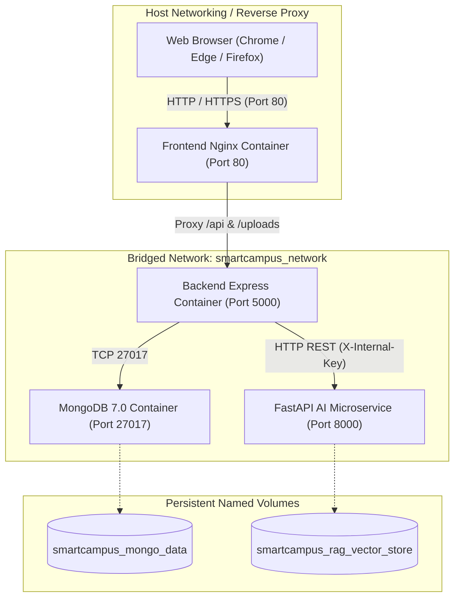
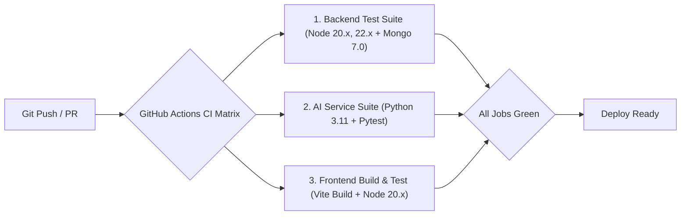

# SmartCampus AI — DevOps, Deployment & Verification Reference

**Document ID:** `09_DEVOPS_DEPLOYMENT_AND_TESTING`  
**Version:** 6.0.0  
**Generated Date:** 2026-10-28  
**Repository Working Directory:** `/Users/anurag93/Downloads/CodingZone/MajorProjects/SMARTCAMPUS`  
**Classification:** DevOps Engineering, Container Orchestration & QA Test Suite Blueprint  

---

## 1. DevOps & Infrastructure Architecture

SmartCampus AI supports two operational execution modes:
1. **Local Bare-Metal Concurrent Mode:** Orchestrated via `scripts/start-all.js` using local Node.js and Python virtual environment processes.
2. **Containerized Production Mode:** Orchestrated via `docker-compose.yml` deploying MongoDB, Python FastAPI, Express Node.js, and Nginx.



---

## 2. Docker & Multi-Container Deployment Reference (`docker-compose.yml`)

### 2.1 Service Specifications

#### 1. `smartcampus-mongodb` (`mongo:7.0`)
* **Base Image:** `mongo:7.0`
* **Exposed Ports:** `27017:27017`
* **Volume Mount:** `mongo-data:/data/db`
* **Healthcheck:**
  ```yaml
  test: ["CMD-SHELL", "mongosh --eval \"db.adminCommand('ping')\" || exit 1"]
  interval: 10s
  timeout: 5s
  retries: 5
  ```

#### 2. `smartcampus-ai-service` (`./ai-service`)
* **Base Dockerfile:** `python:3.11-slim`
* **Exposed Ports:** `8000:8000`
* **Volume Mount:** `rag-vector-store:/app/app/rag/store`
* **Environment Wiring:**
  * `INTERNAL_AI_KEY`: Shared secret key matching backend.
  * `OLLAMA_BASE_URL`: Bridge to host-level LLM runtime (`http://host.docker.internal:11434`).
* **Healthcheck:**
  ```yaml
  test: ["CMD-SHELL", "curl -f http://localhost:8000/health || exit 1"]
  interval: 15s
  timeout: 5s
  retries: 3
  ```

#### 3. `smartcampus-backend` (`./backend`)
* **Base Dockerfile:** `node:20-alpine`
* **Exposed Ports:** `5000:5000`
* **Dependencies:** Depends on `mongodb` and `ai-service` satisfying `condition: service_healthy`.
* **Healthcheck:**
  ```yaml
  test: ["CMD-SHELL", "curl -f http://localhost:5000/api/health/live || exit 1"]
  interval: 15s
  timeout: 5s
  retries: 3
  ```

#### 4. `smartcampus-frontend` (`./client`)
* **Base Dockerfile:** Multi-stage build (Stage 1: `node:20-alpine` runs `npm run build`; Stage 2: `nginx:alpine` serves static files).
* **Exposed Ports:** `80:80`
* **Nginx Configuration (`client/nginx.conf`):** Directs SPA routes to `/index.html` and reverse-proxies `/api/` to `http://backend:5000/api/`.

---

## 3. Local Development Startup Instructions

### 3.1 One-Command Startup (`scripts/start-all.js`)
To execute the complete application stack locally without Docker:
```bash
npm start
# OR
npm run dev
```
**Execution Sequence of `scripts/start-all.js`:**
1. Checks port availability for `5000` (Backend), `5173` (Frontend), and `8000` (AI Service).
2. Spawns Backend process: `node --watch backend/server.js`.
3. Spawns Frontend process: `npm --prefix client run dev`.
4. Spawns AI Service: Invokes Uvicorn in `ai-service/venv` on port 8000.
5. Captures unified process output and handles coordinated `Ctrl+C` termination.

### 3.2 One-Command Shutdown (`scripts/stop-all.js`)
To forcefully release stuck ports after abnormal termination:
```bash
npm run stop
```

---

## 4. Continuous Integration (CI/CD) Workflow (`.github/workflows/ci.yml`)

The repository runs an automated GitHub Actions pipeline on every push or pull request to `master`, `main`, or `develop`:



### CI Job Breakdown:
1. **`backend-tests`:** Matrix across Node.js 20.x and 22.x. Spins up a MongoDB 7.0 service container and runs `npm test` across all backend suites.
2. **`ai-service-tests`:** Spins up Python 3.11, installs `requirements.txt`, and executes `pytest -v`.
3. **`frontend-build`:** Sets `VITE_API_BASE_URL=/api`, installs dependencies, executes `npm run build`, runs `npm test`, and asserts existence of `client/dist/index.html`.

---

## 5. Automated Test Suites & Quality Verification

The test harness incorporates **over 65 automated tests** across Node.js native test runner and Python Pytest.

| Test Suite | File Path | Framework | Test Count / Scope | Execution Command |
|---|---|---|---|---|
| **Backend Core API Integration** | `backend/tests/api.test.js` | `node:test`, `supertest`, `MongoMemoryServer` | 47 integration tests covering Auth, RBAC, Student/Faculty/Admin dashboards, Attendance, Timetable, Exams, AI gateway | `npm --prefix backend test` |
| **Fee Structure & Billing Lifecycle** | `backend/tests/feeManagement.test.js` | `node:test`, `supertest`, `MongoMemoryServer` | 13 integration tests covering structure versioning, publishing, bulk assignment, and offline cashier logging | `node --test backend/tests/feeManagement.test.js` |
| **Payment Gateway & Reconciliation** | `backend/tests/payment.test.js` | `node:test`, `supertest`, `MongoMemoryServer` | 15 integration tests covering Razorpay orders, HMAC signatures, webhooks, idempotency, and PDF receipts | `node --test backend/tests/payment.test.js` |
| **Registration Requests Governance** | `backend/tests/registration.test.js` | `node:test`, `supertest`, `MongoMemoryServer` | 10 integration tests covering registration approval, rejection, and role provisioning | `node --test backend/tests/registration.test.js` |
| **AI ML Risk Classifier** | `ai-service/tests/test_ml_pipeline.py` | `pytest` | 4 unit tests covering benchmark data generation, training, feature scoring, and inference | `pytest ai-service/tests/test_ml_pipeline.py` |
| **RAG Document Engine** | `ai-service/tests/test_rag_pipeline.py` | `pytest` | 5 integration tests covering PDF page extraction, sliding-window chunking, vector indexing, retrieval, and citations | `pytest ai-service/tests/test_rag_pipeline.py` |
| **Recommendations & Assistant** | `ai-service/tests/test_recommendations.py` | `pytest` | 3 unit tests covering weak subject gap analysis, library recommendations, and assistant prompts | `pytest ai-service/tests/test_recommendations.py` |
| **Frontend Smoke & Contracts** | `client/tests/frontend.test.js` | `node:test` | Contract tests verifying exported routes, sidebar links, and component interfaces | `npm --prefix client test` |
| **Live End-to-End Verifier** | `scripts/verify-live-e2e.js` | Node.js E2E | End-to-end integration verifier testing live HTTP endpoints, QR tokens, and AI chat against running servers | `npm run test:live` |
| **Avatar Upload Verifier** | `scripts/test-profile-picture.js` | Node.js E2E | Verifies profile picture upload, magic-byte inspection, file storage, and avatar URL generation | `npm run test:avatar` |

---

## 6. Database Backup & Disaster Recovery Procedures

### 6.1 Database Backup Utility (`backend/scripts/backupDatabase.js`)
* **Execution:** `npm run backup` (or `node backend/scripts/backupDatabase.js`).
* **Procedure:**
  1. Establishes connection to MongoDB via `MONGODB_URI`.
  2. Iterates over all 21 Mongoose models in `CampusModels.js`.
  3. Dumps all documents into timestamped JSON files inside `backend/backups/backup-<ISO_TIMESTAMP>/`.
  4. Generates `backup-metadata.json` recording total document counts per collection.

### 6.2 Database Disaster Restore Utility (`backend/scripts/restoreDatabase.js`)
* **Execution:** `npm run restore` (or `node backend/scripts/restoreDatabase.js`).
* **Procedure:**
  1. Locates most recent backup directory in `backend/backups/`.
  2. Parses JSON collection dumps.
  3. Executes atomic bulk inserts (`insertMany`) per collection, restoring the entire campus database to known good state.

